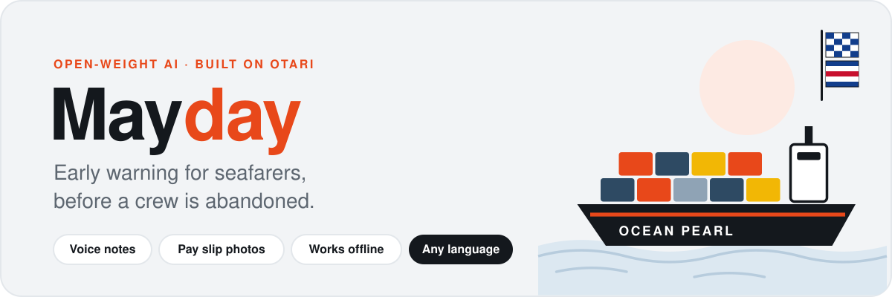
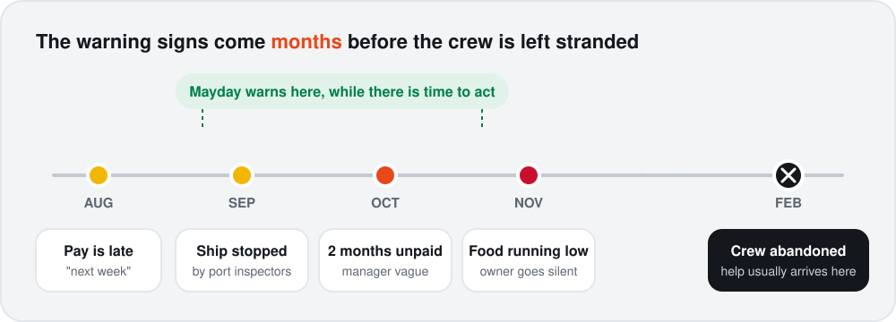
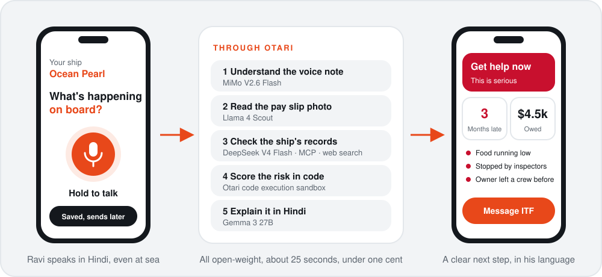
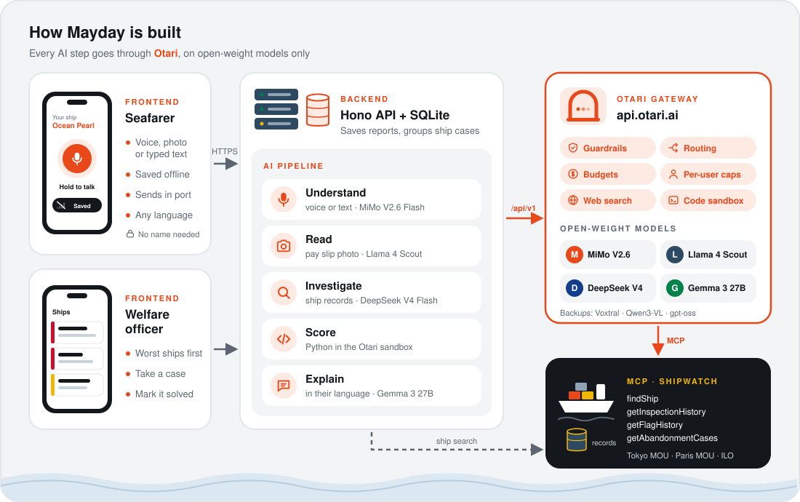

<p align="center">
  
</p>

<p align="center">
  <b>6,223 seafarers were abandoned at sea in 2025.</b><br>
  The warning signs came months earlier. Nobody connected them in time.
</p>

<p align="center">
  <a href="#the-problem">Problem</a> ·
  <a href="#the-solution">Solution</a> ·
  <a href="#architecture">Architecture</a> ·
  <a href="#how-mayday-uses-otari">Otari</a> ·
  <a href="#tech-stack">Tech stack</a> ·
  <a href="#run-it-locally">Run it</a>
</p>

---

## The problem

When a ship owner runs out of money or walks away, the crew is left on board with no wages, food running out, and no way home. In 2025 this happened to a record **6,223 seafarers on 410 ships**, owed **$25.8 million** in wages.

It never happens overnight. Pay stops for weeks, then months. The ship gets stopped by port inspectors. The manager stops answering. The signs are there, but they sit in different places: a seafarer's phone, a port inspection database, a news story about the owner. Existing tools only record a case after the crew is already stranded.

<p align="center">
  
</p>

Sources: [ITF, record abandonment in 2025](https://www.hellenicshippingnews.com/itf-warns-seafarer-abandonment-has-reached-record-levels/) · [Lloyd's List, cases spike in 2024](https://www.lloydslist.com/LL1152206/Seafarer-abandonment-cases-spike-in-2024) · [ILO abandonment database](https://wwwex.ilo.org/dyn/r/abandonment/seafarers/about) · [ITF coordinator gets 60 to 70 WhatsApp messages a day](https://cyprus-mail.com/2026/05/08/itf-coordinator-warns-of-unprecedented-seafarer-crisis-in-conflict-zones)

## The solution

Mayday connects the signs early.

1. A seafarer sends a **voice note**, a **photo of a pay slip**, or a few **typed words**, in their own language.
2. With no signal at sea, it is **saved on the phone** and sends by itself in port.
3. Five open-weight models, all through Otari, understand the message, read the photo, check the ship's public records, score the risk in code, and explain the result in the seafarer's language.
4. The seafarer gets a clear answer: how serious it is, how much they are owed, and what to do today.
5. A welfare officer at the ITF, a union or a port mission sees which ships need help, worst first, and takes the case.

<p align="center">
  
</p>

Seafarers never give their name. Personal details are removed before any model sees them, and a report about someone in danger right now skips the pipeline and shows emergency steps at once.

## Architecture

<p align="center">
  
</p>

| Folder | What it holds |
|---|---|
| [`frontend`](frontend) | The phone app for seafarers and welfare officers. Works offline, later wrapped as an Android app |
| [`backend`](backend) | Receives reports, ignores duplicates, checks them in the background, groups them into ship cases |
| [`ai`](ai) | The Otari pipeline: understand, read, investigate, score, explain |
| [`mcp`](mcp) | Shipwatch, an MCP server with port inspections, flag changes and past abandonment cases |

## How Mayday uses Otari

Every AI call goes through Otari's OpenAI compatible endpoint, on open-weight models only.

| Otari feature | Where Mayday uses it | Code |
|---|---|---|
| Open-weight models | Five steps, four different open-weight models | [`getModelForRole.ts`](ai/src/lib/getModelForRole.ts) |
| Multiple models, distinct roles | Listen, read, investigate, score, explain | [`runReportCheck.ts`](ai/src/reportCheck/runReportCheck.ts) |
| MCP integration | The investigator calls Shipwatch for ship records | [`investigateShip.ts`](ai/src/reportCheck/investigateShip.ts) · [`mcp`](mcp/src/tools) |
| Web search | News about the ship owner | [`investigateShip.ts`](ai/src/reportCheck/investigateShip.ts) |
| Code execution | The risk score runs as Python in the Otari sandbox, checked against the same formula in TypeScript | [`scoreRisk.ts`](ai/src/reportCheck/scoreRisk.ts) · [`riskScore.py`](ai/src/risk/riskScore.py) |
| Routing and fallbacks | Every model name comes from `.env`, so each step can point at an Otari routing policy with a backup model | [`.env.example`](.env.example) |
| Guardrails | Names, passport numbers and prompt injection, checked before the models | Otari dashboard |
| Budgets | A monthly cap for the whole project | Otari dashboard |
| Per-user budgets | Every request carries the anonymous seafarer id, so one person cannot drain the budget | [`askForJson.ts`](ai/src/lib/askForJson.ts) |

### The open-weight models

| Step | Main model | Backup | Input |
|---|---|---|---|
| Understand | `xiaomi/mimo-v2.6-flash` | `mistralai/voxtral-small` | Voice and text |
| Read | `meta/llama-4-scout-17b` | `alibaba/qwen3-vl-30b-a3b-instruct` | Photo |
| Investigate | `deepseek/deepseek-v4-flash` | `openai/gpt-oss-120b` | Text, tools |
| Score | `deepseek/deepseek-v4-flash` | `openai/gpt-oss-120b` | Code sandbox |
| Explain | `google/gemma-3-27b-it` | `mistralai/mistral-small-4` | Text |

## Tech stack

| Part | Built with |
|---|---|
| Language | TypeScript everywhere, run directly by Node 24 with no build step on the server |
| Phone app | Preact, Vite, a service worker and IndexedDB for offline use, Capacitor for Android |
| Server | Hono, SQLite through Node's built-in `node:sqlite` |
| AI | The `openai` SDK pointed at `https://api.otari.ai/api/v1`, zod to check every answer |
| MCP | `@modelcontextprotocol/sdk` over streamable HTTP |
| Hosting | Render for the server and Shipwatch, GitHub Actions to build the Android app |

No agent framework: Otari runs the tool loop for web search, code execution and MCP itself, so each step is one plain function.

## Run it locally

You need Node 24 or newer and an [Otari](https://otari.ai) API key.

```bash
git clone https://github.com/FlemingJohn/mayday.git
cd mayday
npm install
cp .env.example .env
```

Put your key in `.env` as `OTARI_API_KEY`. Then, each in its own terminal:

```bash
npm run seed -w mcp        # load the demo ships
npm run start -w mcp       # Shipwatch on http://localhost:8787/mcp
npm run start -w backend   # API on http://localhost:8080
npm run dev -w frontend    # phone app on http://localhost:5173
```

Try the whole pipeline on a sample report:

```bash
npm run try -w ai
```

Otari has to reach Shipwatch over the internet to use it as an MCP server. Expose it with a tunnel or deploy it, then set `SHIPWATCH_PUBLIC_URL` in `.env`. Without it, Mayday still works and scores reports on what the seafarer sent.

Checks:

```bash
npm run check   # type-check all four folders
npm test        # risk formula tests
```

The demo ship, Ocean Pearl, and its owner are fictional. Its IMO number has a wrong check digit on purpose, so it can never match a real ship.

## Status

Built for the Mozilla Otari hackathon, MozFest Developers Wilding: Online.

| Working | Next |
|---|---|
| Full AI pipeline with emergency path | Recorder, photo picker, offline queue |
| Risk formula in TypeScript and Python, tested to match | Result, records and officer screens |
| Shipwatch MCP server with four tools | Real Tokyo MOU, Paris MOU and ILO data |
| Reports, ship search, ship cases | Android build, proof file |

See [`PLAN.md`](PLAN.md) for the full plan and every edge case, and [`OTARI_FEEDBACK.md`](OTARI_FEEDBACK.md) for what we learned about Otari along the way.

## License

[MIT](LICENSE)
